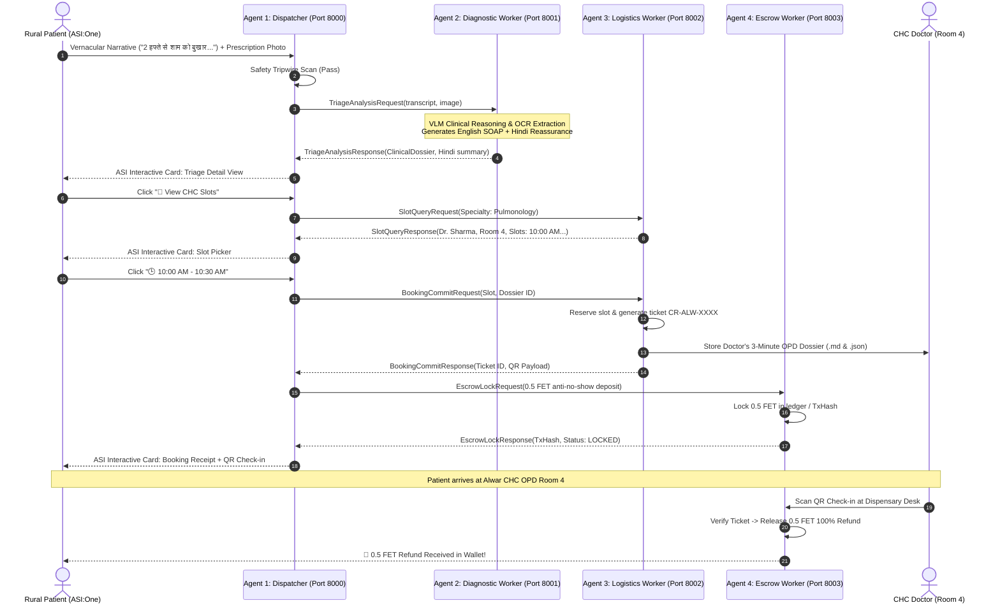

# CareRoute (केयररूट) – Rural Telehealth Bridge & Clinical Pre-Intake Protocol

[](https://fetch.ai)
[](https://asi.one)
[](https://fetch.ai)
[](https://en.wikipedia.org/wiki/SOAP_note)

CareRoute is an autonomous multi-agent healthcare bridge designed for rural Community Health Centers (CHCs) across India. It connects rural patients conversing in vernacular Hindi with overburdened government doctors facing the notorious **3-minute Outpatient Department (OPD) bottleneck**, using the **Fetch.ai / ASI ecosystem** (`uagents`, Agentverse, Agent Chat Protocol, and the Fetch.ai Payment Protocol).

---

## 1. Clinical Motivation & Product Vision

In rural Indian public healthcare facilities (Primary Health Centers and Community Health Centers), an OPD doctor frequently consults **60 to 100+ patients in a single 3-to-4 hour morning shift**. That leaves roughly **180 seconds per consultation** to:
1. Bridge dialect and vernacular gaps (e.g., patient narrating *"शाम को बुखार और 2 हफ्ते से खांसी"*).
2. Decipher crumpled, water-damaged paper prescription slips and unknown OTC medications.
3. Elicit a chronological History of Present Illness (HPI).
4. Formulate differential diagnoses and order appropriate point-of-care laboratory investigations.

**CareRoute transforms this reality through an autonomous two-sided bridge:**

```
                    ┌────────────────────────────────────────────────────────┐
                    │               PATIENT SIDE (VERNACULAR)                │
                    │   Conversational Hindi / Hinglish in ASI:One Chat      │
                    │   Voice Transcripts, Rash Photos, Prescription Slips   │
                    └───────────────────────────┬────────────────────────────┘
                                                │
                                                ▼
┌────────────────────────────────────────────────────────────────────────────────────────────┐
│                       CAREROUTE AUTONOMOUS MULTI-AGENT SWARM                               │
│                                                                                            │
│  [Agent 1: Dispatcher] ──> [Agent 2: Diagnostic] ──> [Agent 3: Logistics] ──> [Agent 4: Escrow] │
│  - ACP State Machine       - VLM Clinical Triager   - CHC Doctor Roster       - 0.5 FET Lock       │
│  - Emergency Tripwires     - Vernacular SOAP Gen    - Slot Reservation        - Desk QR Check-in   │
│  - ASI Interactive Cards   - Prescription OCR       - Doctor Dossier Sync     - 100% Refund Engine │
└───────────────────────────────────────────────┬────────────────────────────────────────────┘
                                                │
                                                ▼
                    ┌────────────────────────────────────────────────────────┐
                    │                 DOCTOR SIDE (CLINICAL)                 │
                    │   3-Minute High-Density English SOAP Intake Dossier    │
                    │   Ranked Differentials + Pre-Populated Lab Checklist   │
                    └────────────────────────────────────────────────────────┘
```

### Safety Tripwires (Zero-Tolerance Red Flags)
If a patient exhibits signs of:
- **Severe Acute Chest Pain** (*"सीने में तेज दर्द / जकड़न"*)
- **Acute Respiratory Distress** (*"सांस फूलना / दम घुटना / Stridor"*)
- **Active Hemorrhage / Hemoptysis** (*"खून की उल्टी / बलगम में खून"*)
- **Altered Sensorium / Shock** (*"बेहोशी / अचेत अवस्था"*)

CareRoute immediately halts standard OPD booking and issues an **Emergency 108 Alert Card** with direct one-touch dialing and emergency transfer protocols.

---

## 2. Multi-Agent Swarm Architecture

The network consists of four specialized autonomous agents communicating asynchronously:



### Agent Roles & Specifications

| Agent | Module | Port | Address Seed | Core Responsibilities |
| :--- | :--- | :---: | :--- | :--- |
| **Dispatcher Gateway** | `agents/dispatcher.py` | `8000` | `careroute_dispatcher_...` | Implements ACP state machine; interacts with ASI:One chat; delivers ASI Interactive Cards; enforces tripwires. |
| **Diagnostic Worker** | `agents/diagnostic_worker.py` | `8001` | `careroute_diagnostic_...` | Multimodal VLM clinical reasoning; vernacular-to-English medical mapping; handwritten prescription OCR; SOAP generation. |
| **Logistics Worker** | `agents/logistics_worker.py` | `8002` | `careroute_logistics_...` | CHC doctor rosters (Alwar CHC); slot allocation; SQLite appointment persistence; doctor dossier generation. |
| **Escrow Worker** | `agents/escrow_worker.py` | `8003` | `careroute_escrow_...` | Fetch.ai Payment Protocol; locks 0.5 FET refundable anti-no-show commitment; settles 100% refund upon clinic QR scan. |

---

## 3. Directory Layout

```
careroute/
├── .env                              # Active environment configuration
├── .env.example                      # Template with ports, seeds & API keys
├── requirements.txt                  # Fetch.ai uagents, core, pydantic, rich
├── config.py                         # Centralized configuration & path resolver
├── models/
│   ├── __init__.py
│   ├── clinical_schemas.py           # SOAP note models, TriageUrgency, MedicationEntry
│   ├── cards.py                      # ASI Interactive Card JSON builders
│   └── chat_models.py                # ACP message envelopes and inter-agent IPC models
├── agents/
│   ├── __init__.py
│   ├── dispatcher.py                 # Agent 1: Master Gateway (ACP + State Machine)
│   ├── diagnostic_worker.py          # Agent 2: Multimodal VLM Triage & SOAP Formatter
│   ├── logistics_worker.py           # Agent 3: CHC Roster & Appointment Booking
│   └── escrow_worker.py              # Agent 4: Payment Protocol & Anti-No-Show Escrow Engine
├── services/
│   ├── __init__.py
│   ├── vlm_service.py                # Multimodal clinical intelligence & mock fallbacks
│   ├── clinic_roster.py              # CHC Doctor rosters with SQLite persistence
│   └── dossier_generator.py          # Formats Doctor's 3-minute OPD Clinical Dossier
├── data/
│   ├── careroute.db                  # SQLite database for bookings & tickets
│   └── dossiers/                     # Persisted JSON and Markdown dossiers
└── main.py                           # Multi-agent Bureau runner & interactive demo
```

---

## 4. Setup & Local Execution

### Prerequisites
- Python 3.9+ (Python 3.10+ recommended)
- `pip` package manager

### 1. Clone & Environment Setup
```bash
git clone https://github.com/your-org/careroute.git
cd careroute

# Create virtual environment
python3 -m venv .venv
source .venv/bin/activate

# Install dependencies
pip install -r requirements.txt
```

### 2. Configure Environment Variables
Copy `.env.example` to `.env`:
```bash
cp .env.example .env
```
Default parameters run out-of-the-box with **deterministic offline clinical intelligence** enabled (`USE_MOCK_VLM=true`), so no paid API keys are required to execute the entire network. If you wish to use live Google Gemini or OpenAI VLMs, simply insert your key:
```ini
GEMINI_API_KEY="your-gemini-api-key"
# or
OPENAI_API_KEY="your-openai-api-key"
USE_MOCK_VLM=false
```

### 3. Run the End-to-End Clinical Demonstration
Execute the rich interactive simulation covering both rural clinical intake and the emergency red-flag tripwire:
```bash
python main.py --demo
```
This tests:
1. Patient Hindi transcript analysis.
2. VLM Clinical Reasoning & SOAP note synthesis.
3. Renders the **ASI Interactive Triage Card**.
4. Renders the **ASI Interactive Slot Picker Card**.
5. Locks **0.5 FET** anti-no-show deposit via `EscrowWorkerAgent`.
6. Renders the **ASI Interactive Booking Receipt & QR Card**.
7. Prints the Doctor's 3-minute English Markdown Clinical Dossier.
8. Simulates physical clinic desk arrival and **100% (0.5 FET) escrow refund**.
9. Triggers the **Critical 108 Emergency SOS Card** on chest pain red-flags.

### 4. Run the Fetch.ai Multi-Agent Bureau
To spin up all 4 agents concurrently inside the `Bureau`:
```bash
python main.py
```
Outputs:
```
INFO:CareRoute.Main:Inter-agent communication addresses linked:
INFO:CareRoute.Main: -> Dispatcher:  agent1qvpsp0r0r4v5wnxtgyyn059323kgyswnvfzz25q8acsftf3q3v5n24nm60q
INFO:CareRoute.Main: -> Diagnostic:  agent1q2czhfp487jdjc3qjpugsuvt0lyzhd7c97nznp8k7mw22huvzvk6sug0923
INFO:CareRoute.Main: -> Logistics:   agent1qgfy3muejfx944p289a8wrahm8n8m4p9s33d735mregnnu4q3w807jkhrmx
INFO:CareRoute.Main: -> Escrow:      agent1q0rsnpndca2xnqr57lzjf4vq2rq2wfnl5kjwm33d0484a3u4xqruyzkr8gn
```

---

## 5. Agentverse Registration & ASI:One Integration

To make CareRoute discoverable globally on the **Fetch.ai Agentverse** and testable directly inside the **ASI:One chat interface**:

### Step 1: Create an Agentverse Mailbox
1. Log in to [Agentverse.ai](https://agentverse.ai).
2. Go to **My Agents** -> Click **+ New Agent**.
3. Select **Mailbox Agent**.
4. Retrieve the **Agent Mailbox Key** from the settings panel.

### Step 2: Configure Dispatcher with Mailbox Key
In `.env`:
```ini
USE_AGENTVERSE=true
AGENTVERSE_API_KEY="your_agentverse_mailbox_api_key_here"
```
Or pass the mailbox parameter directly to the Dispatcher in `agents/dispatcher.py`:
```python
dispatcher = Agent(
    name="careroute_dispatcher",
    seed=Config.DISPATCHER_SEED,
    port=Config.DISPATCHER_PORT,
    mailbox=f"{Config.AGENTVERSE_API_KEY}@https://agentverse.ai",
)
```

### Step 3: Register Agent Chat Protocol (ACP) & Domain Intent
On the Agentverse dashboard:
1. Under **Agent Details**, set:
   - **Name**: `CareRoute (केयररूट) - Rural Telehealth Bridge`
   - **Description**: `Autonomous vernacular clinical pre-intake protocol for rural Indian CHCs. Translates Hindi voice/prescriptions to English SOAP dossiers and locks refundable 0.5 FET anti-no-show deposits.`
   - **Category**: `Healthcare & Telemedicine`
2. Under **Protocols**, register the **Agent Chat Protocol (ACP)** and **Payment Protocol**.
3. Under **Natural Language Intents**, add:
   - *"मुझे डॉक्टर को दिखाना है"*
   - *"दो हफ्ते से खांसी और बुखार आ रहा है"*
   - *"Book rural CHC OPD appointment"*
   - *"Skin rash doctor consultation"*

### Step 4: Interact via ASI:One
1. Open the [ASI:One Mobile/Web Interface](https://asi.one).
2. Search for `@CareRoute` or start chatting with your Agentverse address.
3. Type or voice-record in Hindi:
   > *"नमस्ते, मुझे 2 हफ्ते से शाम को हल्का बुखार आ रहा है और खांसी है।"*
4. CareRoute will reply with reassuring Hindi guidance, followed by the **ASI Interactive Triage Card**, the **Slot Picker Card**, and your **Confirmed OPD QR Ticket**!

---

## 6. Doctor's 3-Minute OPD Clinical Dossier (Sample Output)

Below is an authentic sample of the standardized English SOAP clinical intake slip automatically compiled for the doctor (saved in `data/dossiers/`):

```markdown
# CARE-ROUTE (केयररूट) CLINICAL PRE-INTAKE DOSSIER
**Community Health Center (CHC) Outpatient Department (OPD)**
*Generated by CareRoute Autonomous Telehealth Protocol*

---

### PATIENT INTAKE SUMMARY
- **Ticket ID**: `CR-ALW-76BBA9`
- **Patient Identifier**: `रामकुमार (Ram Kumar, 46M)` (`PAT-ALW-991`)
- **Triage Level**: **[High (Urgent Same-Day / तत्काल परामर्श)]**
- **Target Specialty**: **Pulmonology / Chest & General Medicine** (छाती एवं फेफड़ा रोग विशेषज्ञ)

---

### [S] SUBJECTIVE (Patient Narrative & Vernacular Intake)
- **Raw Vernacular Complaint (Hindi)**:
  > *"नमस्ते डॉक्टर साहब, मुझे दो हफ्ते से शाम को हल्का बुखार आ रहा है, बलगम वाली खांसी है और 3 किलो वजन घट गया है।"*
- **Clinical English Chief Complaint**:
  **Productive cough (>14 days), low-grade evening pyrexia, anorexia, and weight loss (~3 kg).**
- **Duration / Timeline**: `14-20 days (Subacute / Chronic)`
- **History of Present Illness (HPI)**:
  Patient describes a 2-week insidious onset of daily productive cough with whitish sputum, accompanied by evening chills, low-grade fever, diminished appetite (anorexia), and noticeable clothing loosening. Denies current overt hemoptysis or resting dyspnea.
- **Associated Systemic Symptoms**:
  Evening pyrexia, Productive cough, Constitutional weight loss, Anorexia, Night sweats.

---

### [O] OBJECTIVE (VLM Visual Findings & Prescription OCR)
- **Reported Vitals**: Temp: 99.8°F, SpO2: 97% on room air, Respiratory Rate: 20/min
- **OCR Parsed Past Medications (Handwritten Prescription Slip)**:

| Medication Name | Strength / Dose | Regimen / Frequency | Duration | OCR Confidence |
| :--- | :--- | :--- | :--- | :--- |
| Tab. Paracetamol | 500mg | TDS (दिन में तीन बार) | 3 days | 94% |
| Syp. Terbutaline + Bromhexine | 10ml | BD (दिन में दो बार) | 5 days | 88% |

---

### [A] ASSESSMENT (Differential Triage & Clinical Rationale)
- **Ranked Differential Diagnoses**:
  1. Pulmonary Tuberculosis (High index of suspicion: B-symptoms present > 2 weeks)
  2. Community-Acquired Lower Respiratory Tract Infection (Subacute)
  3. Chronic Bronchitis with secondary bacterial superinfection
- **Clinical Rationale & Triage Decision**:
  Triad of prolonged cough (>2 weeks), constitutional evening fever, and documented weight loss strictly satisfies NTEP (National TB Elimination Program) clinical suspect criteria for primary CHC evaluation.

---

### [P] PLAN (Targeted Investigations & OPD Action Plan)
- **Suggested Point-of-Care Investigations (CHC Lab Checklist)**:
  - [ ] Sputum Smear for Acid-Fast Bacilli (AFB) x 2 samples (Early morning & spot)
  - [ ] Cartridge Based Nucleic Acid Amplification Test (CBNAAT / GeneXpert MTB/RIF)
  - [ ] Chest Radiograph (X-Ray PA View)
  - [ ] Complete Blood Count (CBC) with ESR & Fasting Blood Sugar
- **Red-Flag Tripwires Monitored**:
  - ⚠️ Hemoptysis (बलगम में खून आना)
  - ⚠️ Sudden worsening of breathlessness (अचानक सांस फूलना)

---
*Verified by CareRoute Agent Protocol | Anti-No-Show Escrow: 0.5 FET Verified*
```

---

## 7. Two-Minute Video Demonstration Script

**Video Title:** *CareRoute – Bridging Rural Telehealth with Fetch.ai & ASI:One*  
**Duration:** 2 Minutes (120 seconds)  
**Roles:** Narrator (English, clear & authoritative), Patient (Hindi vernacular voiceover).

---

### [00:00 - 00:25] THE PROBLEM: THE 3-MINUTE RURAL OPD BOTTLENECK
- **Visual:** Split screen. On the left, an overcrowded rural Community Health Center (CHC) waiting area in Rajasthan, India. On the right, a timer ticking rapidly down from 03:00 to 00:00.
- **Narrator (VO):**
  > *"In rural India, Community Health Center doctors face an impossible equation: 80 patients in three hours. That’s under three minutes per consultation to decipher local vernacular dialects, inspect faded paper prescriptions, and diagnose complex pathologies. Miscommunication leads to missed diagnoses. Until now."*
- **Visual:** Transition to CareRoute logo with Fetch.ai and ASI:One emblems.

---

### [00:25 - 00:50] PATIENT INTAKE & VLM REASONING
- **Visual:** Smartphone screen showing the **ASI:One** conversational interface. The patient taps the microphone.
- **Patient Voice (Hindi):**
  > *"नमस्ते डॉक्टर साहब, मुझे दो हफ्ते से शाम को हल्का बुखार आ रहा है, बलगम वाली खांसी है और 3 किलो वजन घट गया है।"*
- **Visual:** Patient uploads a photo of an old handwritten medicine slip.
- **Narrator (VO):**
  > *"CareRoute’s Dispatcher Agent receives the vernacular voice transcript. Instantly, our Multimodal Diagnostic Agent analyzes the narrative, parses the handwritten medication slip with OCR, and checks for life-threatening emergency tripwires."*

---

### [00:50 - 01:15] ASI INTERACTIVE CARDS & ESCROW LOCK
- **Visual:** An elegant **ASI Interactive Triage Card** appears inline in ASI:One with an Amber Priority badge: *'Pulmonology / Chest Specialist'*.
- **Visual:** Patient taps *'📅 View CHC Slots'*. The **ASI Slot Picker Card** slides in, displaying Dr. Harish Sharma at Alwar CHC, Room 4. Patient taps *'🕒 10:00 AM'*.
- **Narrator (VO):**
  > *"The patient is guided through native ASI Interactive Cards. When the patient selects an OPD slot, our Escrow Worker Agent initiates the Fetch.ai Payment Protocol, locking a refundable 0.5 FET anti-no-show deposit."*
- **Visual:** A glowing confirmation card: **'Booking Confirmed'** featuring a unique QR check-in token and 0.5 FET escrow lock receipt.

---

### [01:15 - 01:40] THE DOCTOR'S 3-MINUTE CLINICAL DOSSIER
- **Visual:** Cut to the doctor's desk inside Alwar CHC Room 4. On the tablet screen, the standardized **English SOAP Clinical Dossier** is open.
- **Narrator (VO):**
  > *"Before the patient even enters Room 4, the doctor sees a complete English SOAP dossier. Subjective: B-symptoms chronologically organized. Objective: Parsed past medications—Paracetamol 500mg and Terbutaline. Assessment: High suspicion of Pulmonary Tuberculosis per National TB Elimination guidelines. Plan: Pre-ordered Sputum AFB and GeneXpert tests."*
- **Visual:** Doctor glances at the dossier in 15 seconds, smiling and greeting the patient directly.

---

### [01:40 - 02:00] CLINIC DESK QR CHECK-IN & ESCROW SETTLEMENT
- **Visual:** At the CHC dispensary reception, the health worker scans the patient's phone QR code.
- **Narrator (VO):**
  > *"The moment the patient scans their QR code at the clinic desk, the Escrow Agent verifies attendance and immediately refunds the 0.5 FET deposit to the patient’s wallet."*
- **Visual:** Instant notification on patient's phone: *'💸 0.5 FET Escrow Refunded. Check-in Verified.'*
- **Narrator (VO):**
  > *"CareRoute: Zero-friction vernacular intake for patients. High-density clinical dossiers for doctors. Autonomous decentralized healthcare powered by Fetch.ai and ASI:One."*
- **Visual:** Final frame: CareRoute URL, GitHub repo link, and Fetch.ai / ASI ecosystem badges.

---

## 8. License & Attribution

CareRoute is an open-source clinical initiative built on:
- **Fetch.ai uAgents Framework** (`uagents`)
- **Agent Chat Protocol (ACP)** & **Fetch.ai Payment Protocol**
- **National TB Elimination Program (NTEP)** Clinical Pre-Intake Guidelines

Distributed under the Apache 2.0 License.
