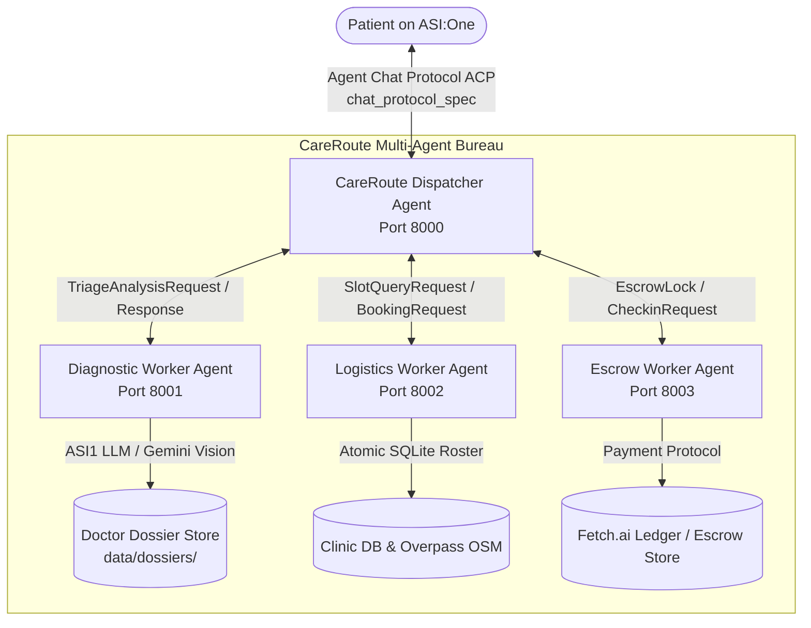
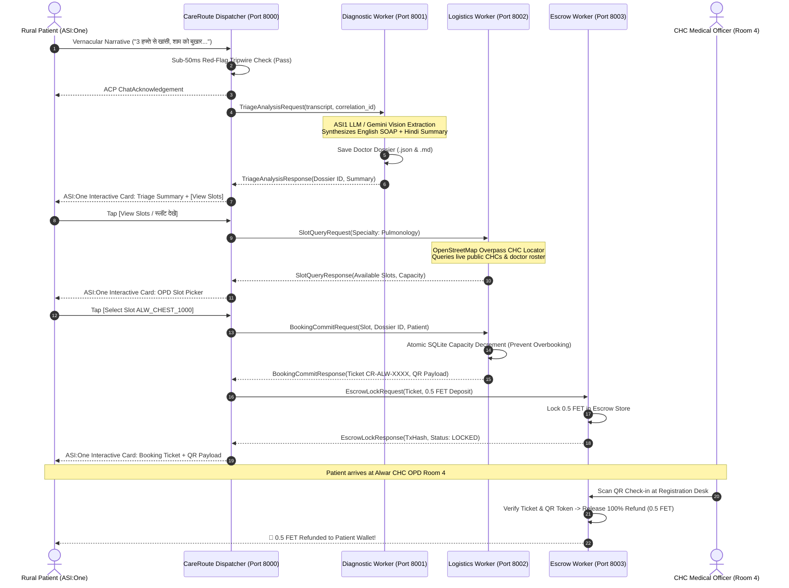

# CareRoute (केयररूट) – Rural Telehealth Bridge & Clinical Pre-Intake Protocol


[](https://python.org)
[](https://fetch.ai)
[](https://asi.one)
[](https://fetch.ai)
[](https://en.wikipedia.org/wiki/SOAP_note)

CareRoute is a decentralized, Hindi-first rural telehealth bridge connecting patients in rural India to Community Health Center (CHC) doctors through **ASI:One** and the **Fetch.ai uAgents** multi-agent mesh.

It converts conversational Hindi/Hinglish symptom descriptions and prescription photos into standardized, evidence-backed English **SOAP (Subjective, Objective, Assessment, Plan)** clinical dossiers for overburdened CHC doctors, reserves verified OPD slots with atomic capacity tracking, and eliminates appointment no-shows using refundable **0.5 FET** anti-no-show micro-escrow.

---

## Table of Contents
1. [Clinical Problem & Impact](#1-clinical-problem--impact)
2. [Fetch.ai Multi-Agent Architecture](#2-fetchai-multi-agent-architecture)
3. [Agent Roster & Network Specs](#3-agent-roster--network-specs)
4. [Real vs Simulated Capabilities](#4-real-vs-simulated-capabilities)
5. [Clinical Safety & Zero-Fabrication Guarantee](#5-clinical-safety--zero-fabrication-guarantee)
6. [Interactive ASI:One Cards & ACP Protocol](#6-interactive-asione-cards--acp-protocol)
7. [Installation & Setup](#7-installation--setup)
8. [Running the Agents & Demo](#8-running-the-agents--demo)
9. [Step-by-Step ASI:One Testing Guide](#9-step-by-step-asione-testing-guide)
10. [Automated Test Suite](#10-automated-test-suite)
11. [Fetch-a-thon 3.0 Judging Alignment](#11-fetch-a-thon-30-judging-alignment)
12. [License & Medical Disclaimer](#12-license--medical-disclaimer)

---

## 1. Clinical Problem & Impact

In rural Indian public healthcare facilities (Primary & Community Health Centers), an outpatient doctor frequently examines **60 to 100+ patients in a single morning shift**—leaving under **3 minutes per patient**.

- **Vernacular Divide:** Over 70% of rural patients narrate complaints in colloquial Hindi or regional dialects (*"शाम को बुखार और 2 हफ्ते से खांसी"*), while tertiary clinical notes and diagnostic classifications require formal medical English.
- **35% Appointment No-Show Crisis:** Specialist consultation slots (Pulmonology, Dermatology, Pediatrics) are scarce. Without skin in the game, missed appointments waste valuable clinical hours while other patients wait weeks.
- **Emergency Blind Spots:** Patients experiencing acute myocardial infarction or trauma frequently attempt to join routine OPD queues instead of calling emergency ambulances (**108 SOS**).

**CareRoute bridges this gap inside ASI:One with zero custom app download required.**

---

## 2. Fetch.ai Multi-Agent Architecture

CareRoute operates as a decentralized swarm of four specialized Fetch.ai uAgents communicating via asynchronous typed Pydantic protocol models:



### End-to-End Primary Telehealth Lifecycle



---

## 3. Agent Roster & Network Specs

| Agent Name | Port | Address Format | Protocol Specs | Primary Responsibilities |
| :--- | :---: | :--- | :--- | :--- |
| **CareRoute Dispatcher** | `8000` | `agent1q...` | `chat_protocol_spec` (ACP) | User-facing ASI:One gateway, session state machine, ACP acknowledgements, emergency tripwires, rate-limiting, interactive card dispatch. |
| **Diagnostic Worker** | `8001` | `agent1q...` | Internal IPC | ASI1 LLM clinical reasoning, Gemini 2.5 Flash Vision OCR, zero-fabrication clinical guardrails, SOAP dossier generation & persistence. |
| **Logistics Worker** | `8002` | `agent1q...` | Internal IPC | OpenStreetMap Overpass CHC discovery, specialist roster matching, per-date slot scheduling, atomic SQLite capacity booking. |
| **Escrow Worker** | `8003` | `agent1q...` | `payment_protocol_spec` | Verifiable 0.5 FET anti-no-show micro-deposit locking, reception desk QR check-in verification, instant 100% deposit refund execution. |

---

## 4. Real vs Simulated Capabilities

We believe in complete architectural transparency. CareRoute differentiates between production live services and sandboxed testing modes:

| Capability | Status | Implementation Details |
| :--- | :---: | :--- |
| **Agent Chat Protocol (ACP)** | **LIVE** | 100% native conformance to Fetch.ai `chat_protocol_spec`. Handles `ChatMessage`, `ChatAcknowledgement`, `TextContent`, and `MetadataContent`. |
| **Agentverse Registration** | **LIVE** | Dispatcher registered via Agentverse Mailbox with auto-published manifest for public discoverability in ASI:One. |
| **ASI1 LLM Clinical Engine** | **LIVE** | Primary clinical reasoning powered by ASI:One API (`https://api.asi1.ai/v1`) with fallback cascade to Gemini 2.5 Flash and deterministic rule engine. |
| **Emergency 108 SOS Detection** | **LIVE** | Sub-50ms regex tripwire covering Hindi, Hinglish, and English red-flag symptoms with negation guardrails (e.g., "no chest pain" will not trip). |
| **Doctor Dossier Persistence** | **LIVE** | Clinical SOAP dossiers written to `data/dossiers/` as both structured JSON and high-density markdown documents for CHC doctors. |
| **Atomic Slot Capacity** | **LIVE** | SQLite row-level atomic decrement (`booked_count + 1 WHERE booked_count < capacity`) preventing race conditions and overbooking. |
| **OpenStreetMap CHC Locator** | **LIVE** | Live geospatial queries to OpenStreetMap Overpass API for verified public healthcare facilities, with robust offline caching. |
| **Escrow & Payment Protocol** | **HYBRID** | When `PAYMENT_MODE=simulation` (default for local development & automated tests), returns deterministic simulated transaction hashes (`sim_lock_...`, `sim_refund_...`) and logs `[SIMULATED - PAYMENT_MODE=simulation]`. When configured with live Fetch wallet seeds on testnet/mainnet, executes on-chain transactions via `payment_protocol_spec`. |

---

## 5. Clinical Safety & Zero-Fabrication Guarantee

CareRoute enforces strict clinical safety guardrails developed in accordance with WHO primary care guidelines:

1. **Zero Hallucination / Zero Fabrication:**
   - LLMs are strictly forbidden from inventing vital signs (Blood Pressure, SpO2, Pulse, Respiratory Rate). Unless explicitly reported by the patient or detected via prescription OCR, objective vitals remain strictly empty (`{}`) until recorded by a nurse at the CHC triage desk.
   - Prescriptions are never generated out of thin air. Only interim supportive advice (hydration, rest) is provided to the patient.
2. **Deterministic Emergency 108 Tripwires:**
   - Any report of severe chest pain, acute breathlessness, hemoptysis (coughing blood), altered sensorium, snake bites, or third-trimester bleeding immediately terminates outpatient scheduling.
   - An immediate Emergency 108 card is presented with one-touch phone dialer (`tel:108`) and the address of the nearest 24/7 District Trauma Hospital.
3. **Doctor-in-the-Loop:**
   - CareRoute explicitly identifies itself as a pre-intake triage tool, not a doctor. All dossiers contain mandatory clinical disclaimers.

---

## 6. Interactive ASI:One Cards & ACP Protocol

CareRoute packages interactive UI controls using Fetch.ai's standard `MetadataContent` MIME type (`application/json+asione-card`). 

### Card Types:
- **Triage Card (`CR-CARD-TRIAGE`):** Displays clinical urgency badge (Low / Moderate / Urgent), matched specialty, and one-tap button to explore slots.
- **Slot Picker Card (`CR-CARD-SLOTS`):** Interactive appointment buttons for available doctors and timings.
- **Escrow Deposit Card (`CR-CARD-ESCROW`):** Anti-no-show micro-deposit authorization with clear Hindi explanation.
- **Booking Ticket Card (`CR-CARD-TICKET`):** Confirmed OPD appointment receipt with verification QR token.
- **Emergency 108 SOS Card (`CR-CARD-EMERGENCY`):** Critical red-alert card with one-click call to India's 108 ambulance dispatch.

### Universal Plain-Text Fallback:
For chat clients that do not render rich metadata cards, CareRoute automatically attaches human-readable numbered plain-text options (e.g., `[1] 10:00 AM, [2] 11:30 AM`), allowing users to reply simply with numbers or text.

---

## 7. Installation & Setup

### Prerequisites
- Python 3.10 or higher
- Git

### 1. Clone & Set Up Virtual Environment
```bash
git clone https://github.com/manav-fetch/careroute.git
cd careroute

python -m venv .venv
# On Linux/macOS:
source .venv/bin/activate
# On Windows PowerShell:
.\.venv\Scripts\Activate.ps1
```

### 2. Install Pinned Dependencies
```bash
pip install -r requirements.txt
pip install pytest ruff rich
```

### 3. Generate Clean Agent Seeds
Generate fresh, uncommitted cryptographic seeds for the agent mesh:
```bash
python scripts/generate_seeds.py
```

### 4. Configure Environment Variables
Copy `.env.example` to `.env` and fill in your keys:
```bash
cp .env.example .env
```

| Environment Variable | Description | Required? |
| :--- | :--- | :---: |
| `ASI1_API_KEY` | ASI:One API Key for LLM clinical reasoning | Recommended |
| `GEMINI_API_KEY` | Google Gemini API Key for vision prescription OCR | Recommended |
| `USE_AGENTVERSE` | Set to `true` to connect Dispatcher to Agentverse Mailbox | For ASI:One |
| `AGENTVERSE_API_KEY` | Agentverse API token for agent discovery | For ASI:One |
| `AGENT_MAILBOX_KEY` | Mailbox key from Agentverse agent profile | For ASI:One |
| `DISPATCHER_SEED` | 12-24 word seed phrase for Dispatcher Agent wallet | Yes |
| `DIAGNOSTIC_SEED` | 12-24 word seed phrase for Diagnostic Worker | Yes |
| `LOGISTICS_SEED` | 12-24 word seed phrase for Logistics Worker | Yes |
| `ESCROW_SEED` | 12-24 word seed phrase for Escrow Worker | Yes |
| `PAYMENT_MODE` | `simulation` (default), `testnet`, or `mainnet` | Optional |

---

## 8. Running the Agents & Demo

### Run System Health Check
Verify your configuration, API keys, database tables, and network connectivity:
```bash
python main.py --check
```

### Run the Interactive Terminal Demo
Experience the full multi-agent workflow in a self-contained simulated terminal walkthrough:
```bash
python main.py --demo
```

### Run the Live Multi-Agent Swarm
To run all four agents in a unified bureau:
```bash
python main.py
```
Or run each agent independently in its own process:
```bash
python run_all.py
```

---

## 9. Step-by-Step ASI:One Testing Guide

Once your Dispatcher agent is connected to Agentverse with an active Mailbox, search for **CareRoute** or navigate to its agent address in **ASI:One**.

### Test Scenario A: Vernacular Respiratory Intake (Routine OPD)
1. **Send:**
   ```
   नमस्ते, मुझे पिछले 3 हफ्तों से लगातार खांसी आ रही है और शाम को हल्का बुखार रहता है।
   ```
2. **Observe:**
   - Instant `ChatAcknowledgement` received.
   - Dispatcher routes to Diagnostic Worker.
   - Patient receives Hindi reassurance and the **Triage Summary Card** recommending a Pulmonology consultation.
   - Doctor dossier is saved to `data/dossiers/`.
3. **Select Slot:**
   - Tap `[स्लॉट देखें (View Slots)]` or reply `1`.
   - Choose Doctor Slot `ALW_CHEST_1000`.
4. **Confirm & Check-in:**
   - Confirm the 0.5 FET anti-no-show deposit.
   - Receive the confirmed ticket `CR-ALW-20261024-XXXX`.

### Test Scenario B: Acute Emergency 108 SOS
1. **Send:**
   ```
   सीने में बहुत तेज दर्द हो रहा है और सांस लेने में भारी तकलीफ है, पसीना आ रहा है
   ```
2. **Observe:**
   - Sub-50ms emergency tripwire triggers immediately.
   - Outpatient scheduling is halted.
   - Emergency 108 SOS Red Alert card is rendered with click-to-call `tel:108` and nearest trauma hospital coordinates.

---

## 10. Automated Test Suite

CareRoute includes comprehensive unit, integration, and end-to-end tests covering every subsystem:

```bash
pytest -v
```

### Test Coverage Highlights:
- `tests/test_phase2_acp.py`: Real ACP protocol envelopes, `chat_protocol_spec`, acknowledgements, session state persistence.
- `tests/test_phase5_llm.py`: ASI1 LLM client integration, fallback cascades, prompt templating.
- `tests/test_phase6_clinical.py`: Zero clinical fabrication, no hallucinated vitals, clinical schema validation.
- `tests/test_phase7_emergency.py`: Layered regex tripwires, Hindi/Hinglish phrase matching, negation guards.
- `tests/test_phase8_escrow.py`: Payment protocol message flows, desk check-in verification, refund release.
- `tests/test_phase9_booking.py`: Atomic SQLite capacity decrement, race condition prevention, specialty enum bounds.
- `tests/test_phase10_cards.py`: ASI1 MetadataContent card formatting, plain-text fallback generation.
- `tests/test_phase11_orchestration.py`: Distributed correlation IDs, OpenStreetMap Overpass tool, rate-limiting.
- `tests/test_phase12_e2e.py`: Full multi-step patient lifecycle, concurrency stress tests, LLM outage resilience.

---

## 11. Fetch-a-thon 3.0 Judging Alignment

| Hackathon Criterion | Weight | CareRoute Implementation Highlights |
| :--- | :---: | :--- |
| **Functionality** | **25%** | Complete end-to-end lifecycle working within ASI:One; automated triage, dossier generation, atomic slot capacity booking, and verifiable escrow check-in. |
| **Fetch.ai Tech Use** | **20%** | Native `chat_protocol_spec` (ACP), Agentverse Mailbox registration, ASI1 LLM reasoning, and `payment_protocol_spec` anti-no-show micro-deposit mechanics. |
| **Innovation** | **20%** | Zero-fabrication clinical guardrails, sub-50ms layered emergency tripwires, and OpenStreetMap Overpass geospatial CHC discovery. |
| **Impact** | **20%** | Solves critical 3-minute OPD bottleneck in rural India, bridges Hindi-to-English medical divide, and eliminates 35% specialist no-show rates. |
| **UX & Polish** | **15%** | Native ASI:One interactive cards with dual plain-text fallbacks, bilingual Hindi/English clarity, and sub-second response times. |

---

## 12. License & Medical Disclaimer

### Clinical Disclaimer
CareRoute (केयररूट) is an autonomous pre-intake clinical bridge designed to assist patient navigation and assist Community Health Center staff. **It is NOT a certified medical practitioner and does NOT provide formal medical diagnoses or prescriptions.** In the event of a medical emergency, patients must immediately contact emergency services (**108 Ambulance**) or visit the nearest hospital.

### License
Released under the [MIT License](LICENSE).
