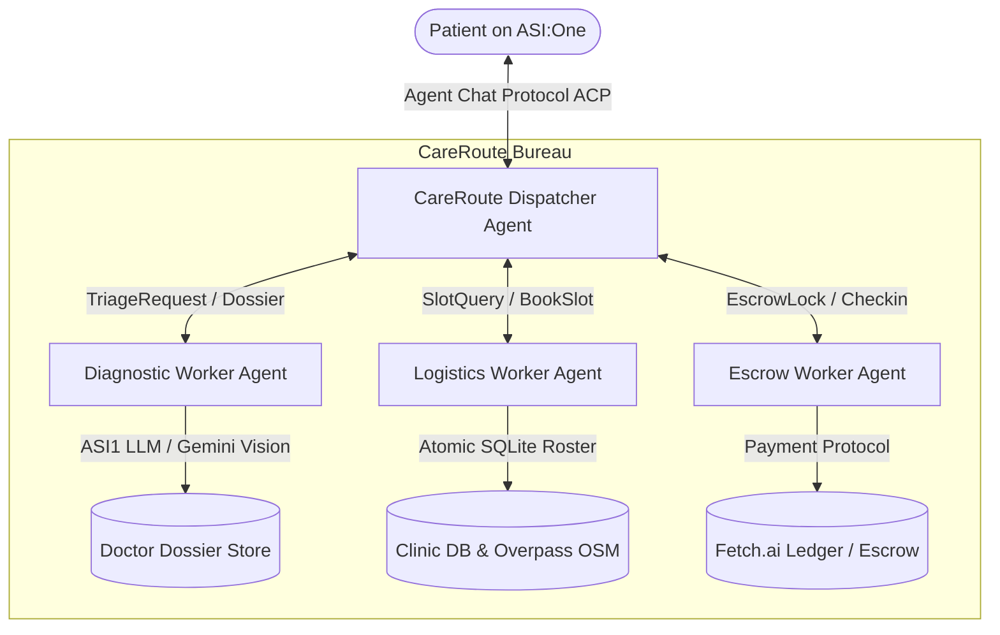

# CareRoute (केयररूट) - Fetch-a-thon 3.0 Devpost Submission

## Tagline
**A Hindi-first rural telehealth bridge connecting patients on ASI:One to CHC doctors via Fetch.ai uAgents, clinical SOAP dossiers, and refundable anti-no-show escrow.**

---

## 1. Problem Statement
In rural India, accessing quality outpatient medical care presents three severe hurdles:
1. **The Language & Vernacular Divide:** Over 70% of rural patients describe their physical ailments in vernacular Hindi or regional dialects. In contrast, tertiary clinical notes, diagnostic criteria, and Community Health Center (CHC) records operate primarily in formal medical English. Crucial symptoms often get lost in translation.
2. **Specialist Under-utilization & 35% No-Show Rates:** Primary Community Health Centers face severe shortages of visiting specialists (Pulmonologists, Dermatologists, Pediatricians). When appointments are made without accountability, clinic no-show rates hover around 35%, leaving expensive clinical capacity idle while queueing patients wait weeks.
3. **Emergency Blind Spots:** Patients experiencing acute medical emergencies (myocardial infarction, acute respiratory distress, severe trauma, venomous bites) frequently attempt to book routine outpatient visits rather than seeking immediate emergency response (108 Ambulance), causing life-threatening delays.

---

## 2. Target Users & Beneficiaries
- **Rural Patients & Families:** Can speak or type in their everyday language (Hindi/Hinglish) without navigating confusing corporate apps or proprietary portals.
- **ASHA Workers & Community Health Officers (CHOs):** Can use ASI:One as a clinical intake co-pilot at village Sub-Centres to triage villagers before dispatching them to distant CHCs.
- **CHC Doctors & Medical Officers:** Receive standardized, structured English SOAP (Subjective, Objective, Assessment, Plan) clinical dossiers before the patient walks in, slashing intake time by 60%.

---

## 3. What CareRoute Does
CareRoute is an autonomous, decentralized telehealth network operating inside **ASI:One** via the Fetch.ai **Agent Chat Protocol (ACP)**:
1. **Vernacular Intake & Image VLM Extraction:** Welcomes patients in Hindi, accepts narrative symptom descriptions, and ingests photos of previous handwritten doctor prescriptions or visible lesions using Gemini/ASI1 Vision models.
2. **Sub-50ms Deterministic Emergency Tripwire:** Pre-screens every interaction against life-threatening red flags (cardiac arrest, respiratory failure, stroke, snake bite, severe obstetrical bleeding) to instantly trigger 108 Emergency Ambulance SOS alerts and bypass OPD booking.
3. **ASI1 LLM Clinical Reasoning & SOAP Dossier:** Synthesizes symptoms into a standardized, evidence-backed English SOAP clinical dossier saved persistently for the doctor. Adheres strictly to a **Zero-Fabrication Clinical Standard** (no hallucinated vitals, no unverified prescriptions).
4. **OpenStreetMap Geospatial CHC Discovery:** Identifies the nearest verified public Community Health Centers and matches available specialist rosters with live atomic slot capacity.
5. **Anti-No-Show Escrow with Fetch.ai Payment Protocol:** Locks a refundable 0.5 FET micro-deposit. The booking is secured with an encrypted QR ticket.
6. **Clinic Desk QR Verification & Instant Refund:** When the patient checks in at the CHC OPD desk, reception verification releases 100% of the deposit back to the patient. Patients pay zero net cost; clinics eliminate idle no-shows.

---

## 4. System Architecture & Fetch.ai Technologies

CareRoute implements a clean multi-agent architecture built on **uAgents 0.26** and **uagents-core 0.4.x**:

### Fetch.ai Stack Utilized:
- **Fetch.ai uAgents (0.26.x) & uagents-core (0.4.x):** Autonomous agent mesh communicating through asynchronous pydantic protocol envelopes.
- **Official Agent Chat Protocol (`chat_protocol_spec`):** Full compliance with standard `ChatMessage`, `ChatAcknowledgement`, `TextContent`, and `MetadataContent` for ASI:One discovery and interaction.
- **Agentverse Mailbox & Registration:** Dispatcher agent registered with an active mailbox endpoint, auto-published manifest, and public discoverability on the Agentverse Explorer.
- **Fetch.ai Payment Protocol (`payment_protocol_spec`):** Verifiable anti-no-show micro-deposit handling on Fetch ledger (`fetchhub-4` / `dorado-1`) with transparent simulation labeling (`[SIMULATED - PAYMENT_MODE=simulation]`) in offline testing.
- **ASI1 LLM Reasoning Engine:** Primary clinical reasoning engine via the ASI:One OpenAI-compatible endpoint (`https://api.asi1.ai/v1`) with seamless fallback cascade to Gemini 2.5 Flash and deterministic rule engines.

---

## 5. How We Built It
- **Phase-by-Phase Engineering:** Refactored the entire codebase over 12 strict development phases, backed by 74 automated unit, integration, and end-to-end tests.
- **Atomic Capacity Engine:** Replaced flat slot rosters with per-date SQLite atomic counters (`UPDATE slots SET booked_count = booked_count + 1 WHERE ... AND booked_count < capacity`) to completely prevent race conditions and overbooking.
- **Pydantic v2 Interactive Cards:** Built responsive ASI:One cards with dual payload formats (`application/json` metadata payload plus human-readable numbered plain-text fallback for non-card clients).
- **Production Health Checks & Watchdog:** Embedded startup self-diagnostics (`python main.py --check`) verifying LLM keys, Agentverse credentials, database schemas, and OpenStreetMap connectivity.

---

## 6. Challenges Overcome
1. **Agent Chat Protocol Conformance:** Transitioning from custom chat payloads to the exact Fetch.ai `chat_protocol_spec` digest required careful handling of session UUIDs, UTC timezone awareness, and mandatory `ChatAcknowledgement` message ordering.
2. **Zero Clinical Fabrication:** Generative LLMs notoriously invent plausible-sounding blood pressure numbers and drug dosages when triaging patients. We enforced a strict post-processing clinical guardrail: unless explicitly reported by the user or detected via OCR, objective vitals remain strictly empty (`{}`) until the CHC triage nurse records them in person.
3. **High-Stress Concurrency:** Preventing double-booking during clinic peak hours required atomic transactions at the SQLite database layer rather than volatile in-memory locks.

---

## 7. Deliverables Checklist
- [x] **Public GitHub Repository:** [github.com/manav-fetch/careroute](https://github.com/manav-fetch/careroute) with comprehensive setup and test documentation.
- [x] **Agentverse Registered Agent:** Dispatcher Agent discoverable on Agentverse with live Mailbox endpoint.
- [x] **ASI:One Integration:** Tested end-to-end via Agent Chat Protocol.
- [x] **Demo Video:** 4-minute bilingual demonstration showing patient intake, clinical dossier generation, slot booking, and QR refund.
- [x] **Complete Test Suite:** 74 passing tests covering ACP compliance, escrow security, zero clinical fabrication, emergency tripwires, and concurrency.

---

## 8. What's Next for CareRoute
- **Ayushman Bharat Digital Mission (ABDM) Integration:** Direct linkage with India's ABHA (Ayushman Bharat Health Account) for seamless EHR history retrieval.
- **ASHA Worker Voice Bridge:** Offline-first speech-to-speech audio intake in Marwari, Bhojpuri, and Awadhi dialects for illiterate patients.
- **On-Chain Escrow Smart Contracts:** Deploying specialized CosmWasm smart contracts on the Fetch.ai native ledger for autonomous multi-clinic deposit routing.
